# DevKora

**Le point de rencontre des devs africains.**
Trouve des missions. Partage tes connaissances. Construis avec les tiens.

DevKora répond au thème du concours CADEV 2026 : *« Construire la plateforme d'échange africaine, pour les devs, par les devs. »*

| Le thème | Dans DevKora |
|---|---|
| **Plateforme d'échange** | Questions-réponses, articles, annonces « Cherche coéquipiers » et missions entre devs, événements |
| **Africaine** | Mobile Money, montants en FCFA, Le Pouls (« Combien facturer ? »), pages ville, pages légères pour la 3G |
| **Pour les devs** | Aucun client extérieur : les missions s'échangent entre développeurs |
| **Par les devs** | Les cauris débloquent des privilèges, jusqu'à la modération par la communauté |

Le nom réunit « Dev » et la **kora**, l'instrument d'Afrique de l'Ouest dont les 21 cordes ne sonnent juste qu'ensemble : chaque dev apporte sa note.

**Démo : bientôt en ligne**, hébergée à Dakar. La démo propose une connexion en un clic avec trois comptes : Moussa (dev Laravel, Dakar), Aïssatou (dev Flutter, Abidjan) et Koffi (modérateur, Lomé). Elle est remise à zéro chaque nuit à 3 h.

## Captures

| | |
|---|---|
|  | 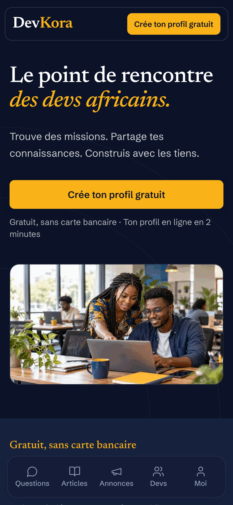 |
| Accueil (ordinateur, clair) | Accueil (mobile, sombre) |
| 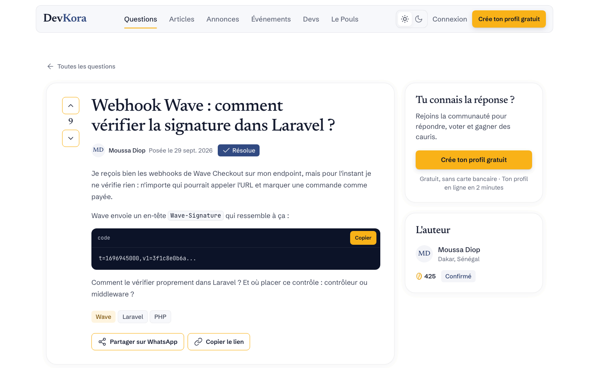 |  |
| Question résolue, code coloré côté serveur | Recherche plein texte, sans accents |
| 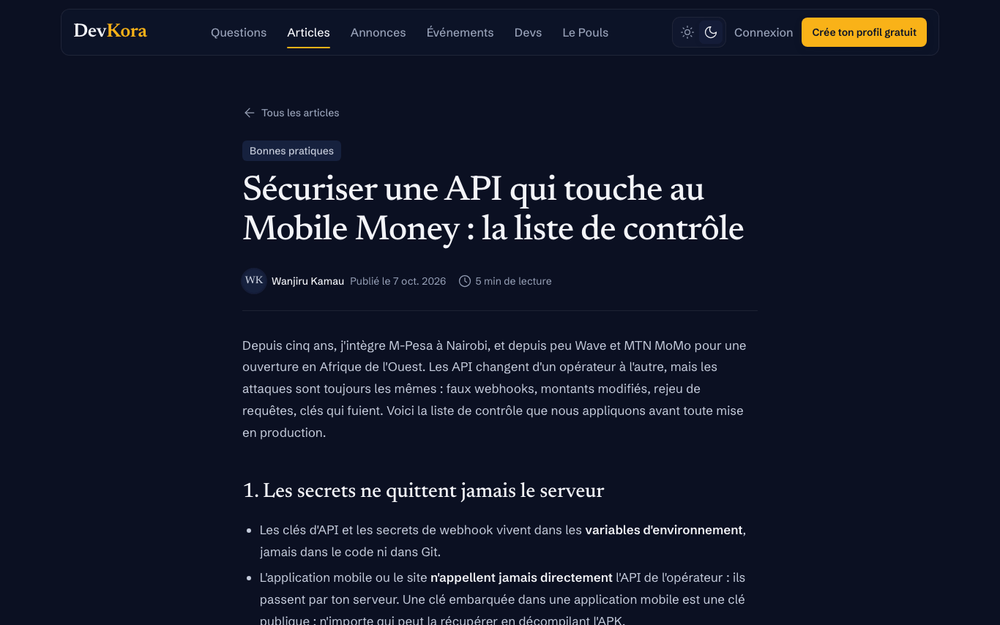 | 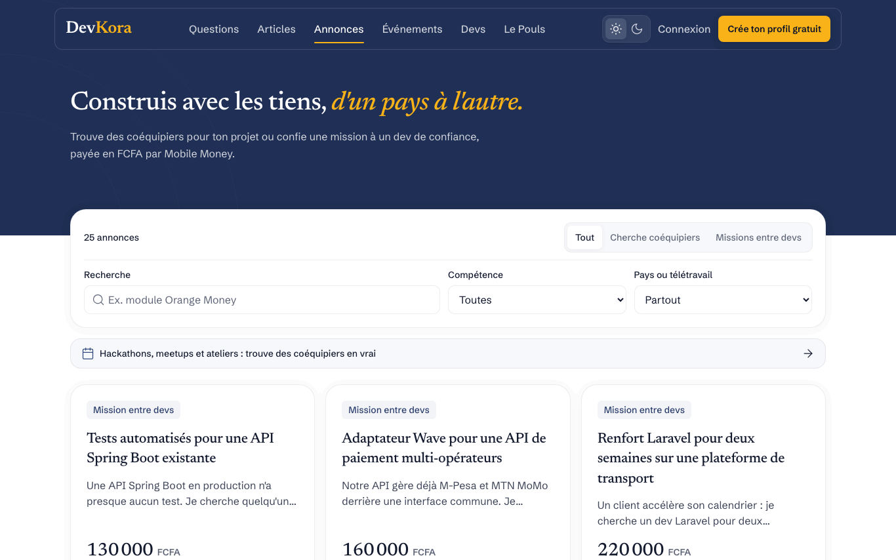 |
| Article (sombre) | Annonces : équipes et missions entre devs |
| 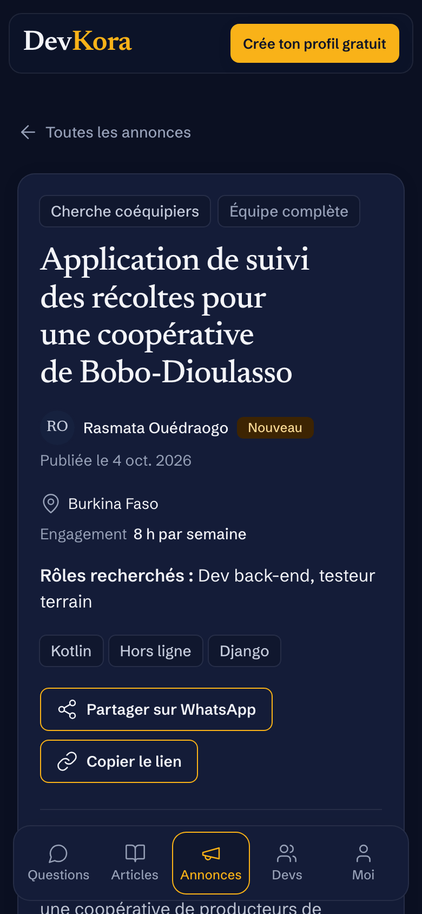 | 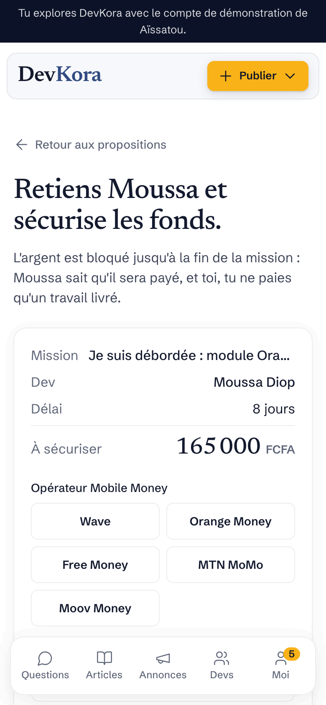 |
| Équipe formée entre plusieurs pays | Séquestre Mobile Money simulé |
| 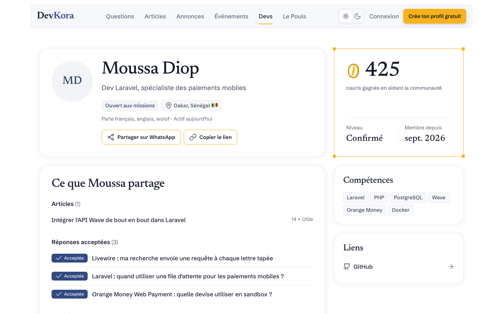 | 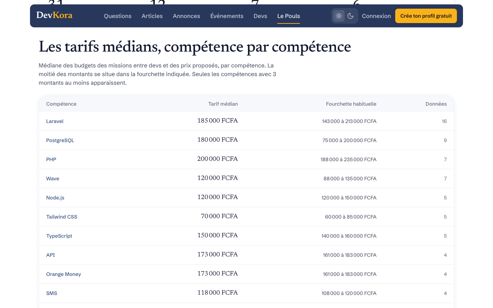 |
| Profil : cauris, compétences, avis | Le Pouls : tarifs médians en FCFA |
| 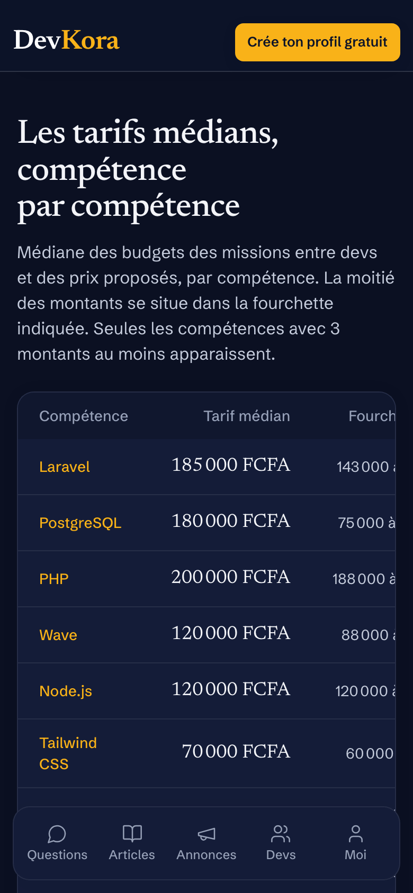 | 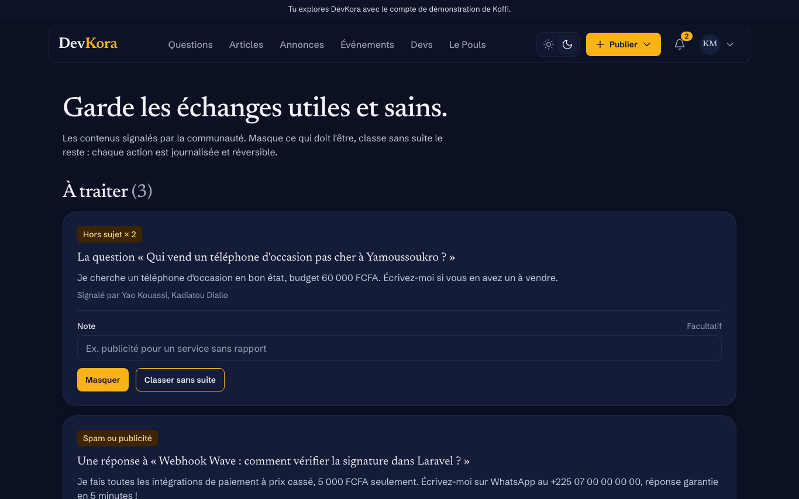 |
| Le Pouls (mobile, sombre) | Modération par la communauté |
| 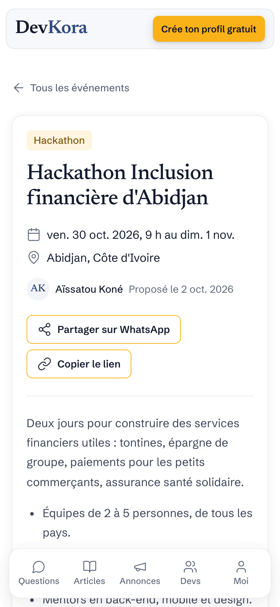 | |
| Événement : meetup, atelier, hackathon | |

## Fonctionnalités

**Entraide**
- Questions-réponses en Markdown, code coloré côté serveur, votes, réponse acceptée, questions similaires pendant la saisie.
- Articles (tutoriels, retours d'expérience), vote « Utile », temps de lecture.
- Recherche plein texte PostgreSQL, insensible aux accents.

**Communauté**
- Annonces « Cherche coéquipiers » et « Mission entre devs », propositions, équipe formée.
- Cycle complet d'une mission : proposition retenue, fonds en séquestre (Wave, Orange Money, Free Money, MTN MoMo, Moov Money, **simulé**), fin de mission, avis sur trois critères.
- Estimateur de budget à partir des missions similaires.
- Annuaire des devs filtrable, pages ville (`/villes/dakar`), événements avec « J'y participe ».

**Par les devs**
- Réputation en **cauris**, commune à l'entraide et aux missions, avec niveaux et contributeurs du mois.
- Privilèges débloqués : vote négatif (50), modération communautaire (250), modification des tags (500).
- Signalements, file de modération, actions journalisées et réversibles, notifications.

**Le Pouls** : tarifs médians en FCFA par compétence, compétences recherchées par pays, devs par pays, activité des 30 derniers jours.

**Partout** : mobile d'abord, thème clair et sombre, tutoiement, partage WhatsApp, Open Graph, plan du site.

## Stack

| Couche | Choix |
|---|---|
| Langage | PHP 8.2 |
| Framework | Laravel 12, Fortify (authentification) |
| Interactivité | Livewire 3 sur les pages qui en ont besoin, Alpine.js seul ailleurs |
| Base de données | PostgreSQL 16 (recherche plein texte, `unaccent`) |
| Styles | Tailwind CSS 4, polices auto-hébergées, aucune ressource externe |
| Images | Intervention Image (photos de profil en WebP) |
| Tests | Pest 3, Playwright (mesures réelles dans Chromium) |
| Serveur | Nginx, PHP-FPM, systemd, Ubuntu, à Dakar |

## Architecture

Un monolithe Laravel, rendu côté serveur :

```
app/
├── Http/Controllers   pages et formulaires (un contrôleur fin par ressource)
├── Http/Requests      validation côté serveur
├── Livewire           listes filtrables, formulaires d'écriture, votes
├── Policies           qui peut faire quoi (auteur, privilèges, modération)
├── Services           règles métier : réputation, votes, paiement simulé, modération, Le Pouls…
├── Models             Eloquent, avec carte polymorphe et recherche plein texte
├── Notifications      cloche des membres
└── Support            textes, pays, villes, navigation, crédits des licences
```

- **Les contrôleurs et composants délèguent aux services** : une règle (par exemple les cauris d'une réponse acceptée) n'existe qu'à un endroit, et les données de démo passent par les mêmes services.
- **Chaque écriture** passe par une Policy, une validation côté serveur et une limite de débit.
- **Pages légères** : Livewire n'est chargé que sur les pages qui ont un composant ; ailleurs, Alpine seul. L'accueil pèse moins de 70 Ko sur mobile (polices exclues).
- **Sécurité** : CSP stricte, aucune origine externe, Markdown échappé, cookies sécurisés, paiement entièrement simulé.

## Installation locale

Prérequis : PHP 8.2 (extensions pgsql, mbstring, intl, gd), Composer, Node.js 20.19 ou plus, PostgreSQL 16.

```bash
composer install
npm install
cp .env.example .env
php artisan key:generate
createdb devkora
php artisan migrate --seed
php artisan storage:link
npm run build
```

Pour la connexion en un clic avec les comptes de démonstration, mets `APP_DEMO=true` dans `.env`. `php artisan demo:reset` remet les données de démonstration à zéro (seulement si `APP_DEMO=true`).

## Tests

```bash
createdb devkora_test
npx playwright install chromium   # une seule fois, pour les tests navigateur
php artisan test
```

- **Feature et Unit** : chaque parcours, chaque refus (403, validation), l'audit de sécurité automatisé et les fichiers de déploiement.
- **Reset** : `demo:reset` à trois dates différentes.
- **Browser** : aucun débordement à 360 px en clair et en sombre, poids de l'accueil, et CSP de production sans aucune violation sur toutes les pages.

## Déploiement

Tout est dans le dossier [`deploy/`](deploy/) :

- [`deploy/deploy.sh`](deploy/deploy.sh) : déploiement idempotent (code, dépendances, build, migrations, caches, rechargement de PHP-FPM) ;
- [`deploy/nginx/`](deploy/nginx/) : HTTPS, gzip, cache des assets, en-têtes de sécurité et CSP ;
- [`deploy/php-fpm/`](deploy/php-fpm/) : pool dédié ;
- [`deploy/systemd/`](deploy/systemd/) : planificateur (remise à zéro de la démo à 3 h, heure de Dakar) ;
- [`.env.example.production`](.env.example.production) : configuration de production commentée, sans secret.

## Licences

Toutes les dépendances sont sous licence permissive. Elles sont lues dans `composer.lock` et `package-lock.json`, et listées sur la page À propos de l'application.

| Brique | Licence |
|---|---|
| Laravel, Fortify, Livewire, Alpine.js, Intervention Image, Tailwind CSS | MIT |
| league/commonmark, highlight.php | BSD-3-Clause |
| Polices Newsreader, Schibsted Grotesk, JetBrains Mono | SIL OFL 1.1 |
| Icônes Lucide | ISC |
| PostgreSQL | PostgreSQL License |

## Usage de l'intelligence artificielle

- Claude Code (Anthropic) : code, tests et revue de code.
- ChatGPT (OpenAI) : image d'illustration de l'accueil.

## Équipe

**Baobab Stack** (Sénégal), pour le concours CADEV 2026 organisé par Systalink : Yaya Niang (représentant), Aminata Sall.

Wave, Orange Money, Free Money, MTN MoMo et Moov Money sont les marques de leurs propriétaires. DevKora n'a aucune affiliation avec eux, et le paiement des missions est simulé : aucun argent réel n'est débité.
